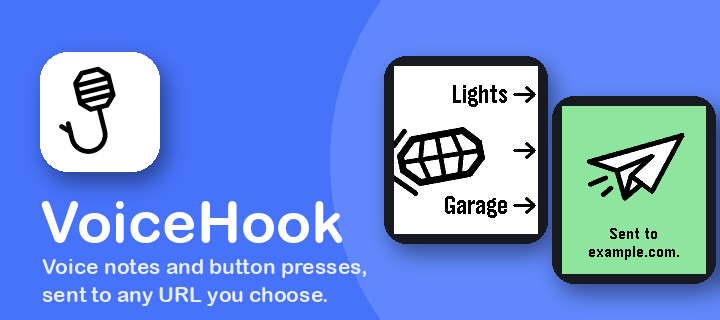
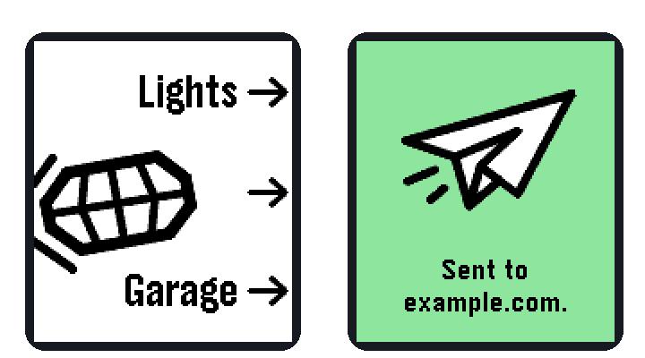
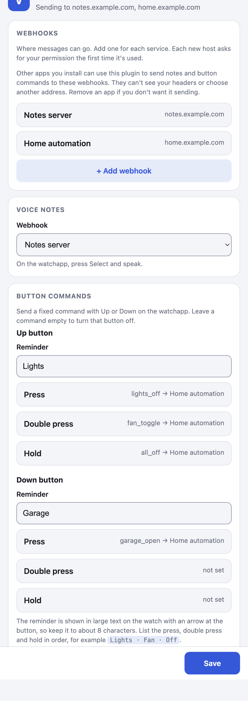

<p align="center"></p>

**VoiceHook sends voice notes and button presses from your Pebble to any URL you choose.** Press Select, say your
note, and it arrives as an HTTP POST at your own server, home automation or note system, with the headers you set.
Up and Down send fixed commands, six in all.

It has no server, no account and no analytics: messages go only to the webhooks you enter.

<table>
<tr>
<td align="center" valign="top"><br><sub>On the watch: ready, and sent</sub></td>
<td align="center" valign="top"><br><sub>Settings, in the Pebble app</sub></td>
</tr>
</table>

## What you get
- **Voice notes.** Select starts dictation; the text is sent as JSON or plain text.
- **Six button commands.** Up and Down, each as a press, a double press or a hold, each to the webhook you pick, with
  optional extra headers.
- **Several webhooks**, each with its own URL, headers and format.
- **Reminders on the watch:** your own words next to the Up and Down buttons, with an arrow at each.
- **Quick Launch:** put VoiceHook on a Quick Launch button to start a note from anywhere. It closes by itself.
- **A plugin other apps can use** to send to your webhooks (below).

## Set up
1. Open VoiceHook's settings in the Pebble app and paste your webhook's URL.
2. Add a header if it needs one, such as `Authorization`.
3. Tap **Save & send test message** and allow the connection when your phone asks.

Then press Select on the watch and talk. Set the six button commands on the same page.

## What your server receives
A note: `POST <your URL>` with your headers and the body

```json
{ "text": "buy milk", "timestamp": "2026-11-24T10:15:00.000Z", "source": "pebble" }
```

A button command sends `{ "command": "lights_off", "timestamp": "...", "source": "pebble" }`. The field name for
notes is configurable, or choose plain text and the body is just the message. A `2xx` answer counts as success.
Redirects aren't followed, so use the final URL.

## Use the plugin from your own app
The plugin works on its own. Any Pebble app can call it with `Pebble.invokeAction`:

```js
Pebble.invokeAction({ plugin: '<plugin uuid>', action: 'send_message', args: { text: 'buy milk' } });
Pebble.invokeAction({ plugin: '<plugin uuid>', action: 'send_command', args: { slot: 'up_single' } });
```

`send_message` posts to the voice-note webhook and `send_command` to the webhook set for that button
(`up_single`, `up_double`, `up_hold`, `down_single`, `down_double`, `down_hold`). Callers can't read headers or choose
an address: everything goes to the webhooks the user set up. Each action answers at most one request a second.
The plugin's uuid is `020583bc-828e-454c-b579-de76d60ec3e6`; the watchapp bundles its own copy, which uses the
watchapp's uuid.

## Privacy
Your URLs and header values are kept in the Pebble app's encrypted plugin storage on your phone, never shown again
after you save them, and a saved value is only sent to the address it was saved for. See [PRIVACY.md](PRIVACY.md).

## Develop
See [docs/DEVELOPING.md](docs/DEVELOPING.md) for the layout, building, testing and the tools. The words used in the
code and the UI are in [GLOSSARY.md](GLOSSARY.md). To publish, follow [PUBLISHING.md](PUBLISHING.md).

## Licence
[MIT](LICENSE). The icons come from the [Pebble iconography](https://github.com/pebble-dev/iconography) set
(Apache 2.0), see [app/resources/images/ATTRIBUTION.md](app/resources/images/ATTRIBUTION.md).
